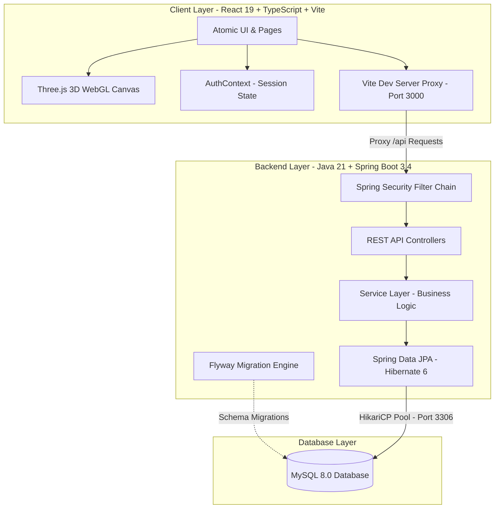

<div align="center">

<!-- Hero Banner -->


<p align="center">
  <a href="https://git.io/typing-svg">
    
  </a>
</p>

<!-- Badges -->
<p align="center">
  
  
  
  
  
  
  
  
</p>

<p align="center">
  <b>A state-of-the-art competitive gaming ecosystem featuring interactive 3D WebGL scenes, live tournament brackets, verified squad rosters, and enterprise-grade Spring Boot architecture.</b>
</p>

---

[Key Features](#-key-features) • [System Architecture](#-system-architecture) • [Tech Stack](#-technology-stack) • [Quickstart Guide](#-quickstart-guide) • [API Reference](#-api-reference) • [Demo Accounts](#-demo-accounts)

---

</div>

<br />

## 🌟 Key Features

<table>
  <tr>
    <td width="50%">
      <h3>🎮 Cinematic 3D Hero & Arena</h3>
      <ul>
        <li><b>Dynamic WebGL Canvas:</b> Real-time 3D models with interactive mouse physics (<i>Orb Core</i> and <i>Trophy Nexus</i>).</li>
        <li><b>Video + Holo Mode:</b> Seamless toggle between ultra-widescreen cinematic video loop and cyberpunk holographic poster fallback.</li>
        <li><b>Cyber Sound FX:</b> Interactive Web Audio synthesized futuristic clicks and sound feedback.</li>
      </ul>
    </td>
    <td width="50%">
      <h3>🏆 Tournament Operations</h3>
      <ul>
        <li><b>Multi-Game Ecosystem:</b> Native support for Valorant, CS2, League of Legends, Rocket League, and Dota 2.</li>
        <li><b>Automated Brackets:</b> Single & Double Elimination formats with visual seeds and status lifecycles.</li>
        <li><b>Verified Registrations:</b> Real-time roster validation, captain check-in, and slot capacity management.</li>
      </ul>
    </td>
  </tr>
  <tr>
    <td width="50%">
      <h3>🛡️ Squad & Team Management</h3>
      <ul>
        <li><b>Captains & Rosters:</b> Designate squad captains, assign starter roles, and control team metadata.</li>
        <li><b>Team Finder:</b> Searchable team directory filtering by game title, region, and recruitment status.</li>
        <li><b>Atomic Constraints:</b> Enforces captain permissions, roster integrity, and single-team-per-tournament rules.</li>
      </ul>
    </td>
    <td width="50%">
      <h3>🏅 Gamified Player Passport</h3>
      <ul>
        <li><b>XP & Progression:</b> Dynamic XP calculation, level progression (Bronze to Radiant), and seasonal points.</li>
        <li><b>Season 4 Pass:</b> Competitive tier tracking, milestone rewards, and college league rankings.</li>
        <li><b>Leaderboards:</b> Real-time collegiate standings with win rates and performance analytics.</li>
      </ul>
    </td>
  </tr>
</table>

<br />

## 🏛️ System Architecture



<br />

## 💻 Technology Stack

| Layer | Technologies | Description |
| :--- | :--- | :--- |
| **Frontend Framework** | **React 19, TypeScript, Vite 8** | Ultra-fast build toolchain with Strict TypeScript typing |
| **3D & Graphics** | **Three.js, @react-three/fiber, @react-three/drei** | WebGL shader materials, interactive particle systems & 3D trophy models |
| **Styling & UI** | **Tailwind CSS 4, Motion, Lucide Icons** | Glassmorphism aesthetics, neon cyberpunk glowing accents |
| **Backend Core** | **Java 21 LTS, Spring Boot 3.4.3** | High-performance enterprise REST API runtime |
| **Security & Auth** | **Spring Security 6, BCrypt, HTTP-Only Sessions** | Role-based access control (`PLAYER`, `CAPTAIN`, `ORGANIZER`, `ADMIN`) |
| **Persistence** | **Spring Data JPA, Hibernate 6, HikariCP** | Robust transaction management and connection pooling |
| **Database & Migration** | **MySQL 8.0+, Flyway Migration** | 19 relational tables with indexes, foreign keys, and audit timestamps |
| **Automated Testing** | **JUnit 5, Mockito, SpringBootTest** | Comprehensive test suite covering units, services, and integration endpoints |

<br />

## 📁 Repository Structure

```
esports-management-system/
├── frontend/                               # React + TypeScript + Vite Client
│   ├── src/
│   │   ├── components/
│   │   │   ├── 3d/                         # WebGL Canvas (CinematicOrb & TrophyNexus)
│   │   │   ├── hero/                       # HeroSection with video & 3D fallback modes
│   │   │   ├── common/                     # Atomic UI (Button, Input, Modal, Badge)
│   │   │   ├── layout/                     # AppShell, Navbar, Footer
│   │   │   ├── teams/                      # TeamCard, Team creation modal
│   │   │   └── tournaments/                # Tournament cards, brackets & registration
│   │   ├── context/                        # AuthContext (user session hydration)
│   │   ├── lib/                            # Centralized API client & DTO mappers
│   │   ├── pages/                          # Home, Tournaments, Teams, Leaderboards, Seasons, Auth
│   │   └── types/                          # TypeScript contracts matching Spring Boot DTOs
│   ├── vite.config.ts                      # Reverse proxy (/api -> http://localhost:8080)
│   └── package.json
│
├── backend/                                # Java Spring Boot 3 Backend
│   ├── src/main/java/com/esports/nexus/
│   │   ├── config/                         # SecurityFilterChain, CORS & AuthProvider
│   │   ├── common/                         # GlobalExceptionHandler & standardized ApiResponse
│   │   ├── user/                           # Users, Roles, Authentication, Password hashing
│   │   ├── profile/                        # Player Passport profiles, levels, XP
│   │   ├── game/                           # Competitive titles (Valorant, CS2, etc.)
│   │   ├── team/                           # Teams, rosters, captains & recruitment
│   │   ├── tournament/                     # Tournaments, formats, stages & lifecycles
│   │   ├── registration/                   # Squad registration constraints & capacity
│   │   └── seeder/                         # Idempotent development data seeder
│   ├── src/main/resources/
│   │   ├── application.yml                 # MySQL connection & server configuration
│   │   └── db/migration/V1__initial_schema.sql # 19 relational MySQL tables
│   ├── pom.xml                             # Maven dependencies & build lifecycle
│   └── mvnw.cmd                            # Embedded Maven wrapper
│
├── setup-database.sql                      # Database initialization script
├── start-backend.ps1                       # One-click PowerShell backend launcher
├── test-api.ps1                            # Automated end-to-end API test script
└── README.md
```

<br />

## 🚀 Quickstart Guide

### 1. Prerequisites
* **Java Development Kit:** Java 21+ (`java -version`)
* **Node.js:** v18+ (`node -v`)
* **MySQL Server:** MySQL 8.0+ running on port `3306`

---

### 2. Database Setup (MySQL)
Open your MySQL terminal or Workbench and run:
```sql
CREATE DATABASE IF NOT EXISTS esports_nexus 
CHARACTER SET utf8mb4 
COLLATE utf8mb4_unicode_ci;
```

Configure credentials in `backend/.env`:
```env
SERVER_PORT=8080
DB_HOST=localhost
DB_PORT=3306
DB_NAME=esports_nexus
DB_USERNAME=root
DB_PASSWORD=your_mysql_password_here
CORS_ALLOWED_ORIGINS=http://localhost:3000,http://localhost:5173
SESSION_TIMEOUT_SECONDS=86400
```

---

### 3. Launch the Backend
From the root directory:
```bash
# Using PowerShell launcher (loads .env automatically):
.\start-backend.ps1

# Or directly via Maven:
cd backend
.\mvnw.cmd spring-boot:run
```
*API starts on **`http://localhost:8080`** and Flyway automatically creates all 19 relational tables.*

---

### 4. Launch the Frontend
From the root directory:
```bash
npm run dev
# or
cd frontend && npm run dev
```
*Open **`http://localhost:3000`** in your browser.*

---

### 5. Run Verification & Tests

#### Automated Backend Test Suite
```bash
cd backend
.\mvnw.cmd test
```
*Executes all 20 JUnit 5 integration and service unit tests against an isolated H2 in-memory profile.*

#### Automated End-to-End API Test
```powershell
powershell -ExecutionPolicy Bypass -File .\test-api.ps1
```
*Verifies Health, Games, Registration, Login, Session (`/me`), Tournaments, and Squads in real-time.*

#### Frontend Production Build
```bash
npm run build --prefix frontend
```
*Runs `tsc -b && vite build` and generates an optimized production distribution in `frontend/dist/`.*

<br />

## 📡 REST API Reference

| Method | Endpoint | Description | Auth Required |
| :---: | :--- | :--- | :---: |
| `GET` | `/api/v1/health` | Safe system health & MySQL ping check | No |
| `POST` | `/api/v1/auth/register` | Register new user, create Player Passport & session | No |
| `POST` | `/api/v1/auth/login` | Authenticate credentials & set `JSESSIONID` cookie | No |
| `POST` | `/api/v1/auth/logout` | Invalidate session & clear security context | Yes |
| `GET` | `/api/v1/auth/me` | Retrieve authenticated profile, stats & level | Yes |
| `GET` | `/api/v1/games` | List all active competitive titles | No |
| `GET` | `/api/v1/teams` | Search active teams (`?gameId=...`, `?recruiting=true`) | No |
| `POST` | `/api/v1/teams` | Create squad roster (designates creator as Captain) | Yes |
| `GET` | `/api/v1/tournaments` | List tournaments (`?status=...`, `?gameId=...`) | No |
| `GET` | `/api/v1/tournaments/{id}` | Retrieve tournament rules, format & live roster | No |
| `POST` | `/api/v1/tournaments/{id}/registrations` | Register squad for tournament bracket | Yes (Captain) |
| `GET` | `/api/v1/tournaments/{id}/registrations` | Retrieve registered squads for a tournament | No |

<br />

## 🔑 Demo Accounts

The application automatically seeds idempotent demo data on first boot:

| Username | Role | Password | Description |
| :--- | :---: | :---: | :--- |
| `kaizen_v` | **CAPTAIN** | `NexusPlayer#2026` | Captain of *Vanguard Sentinels* (Valorant) |
| `valkyriex` | **CAPTAIN** | `NexusPlayer#2026` | Captain of *Eclipse Syndicate* (CS2) |
| `nexus_organizer` | **ORGANIZER** | `NexusPlayer#2026` | Sanctioned tournament bracket organizer |

<br />

## 📜 License & Credits

Distributed under the **MIT License**. Created by [Dhruvesh Bhamare](https://github.com/Dhruveshbhamare11).

<div align="center">
  <br />
  
</div>
